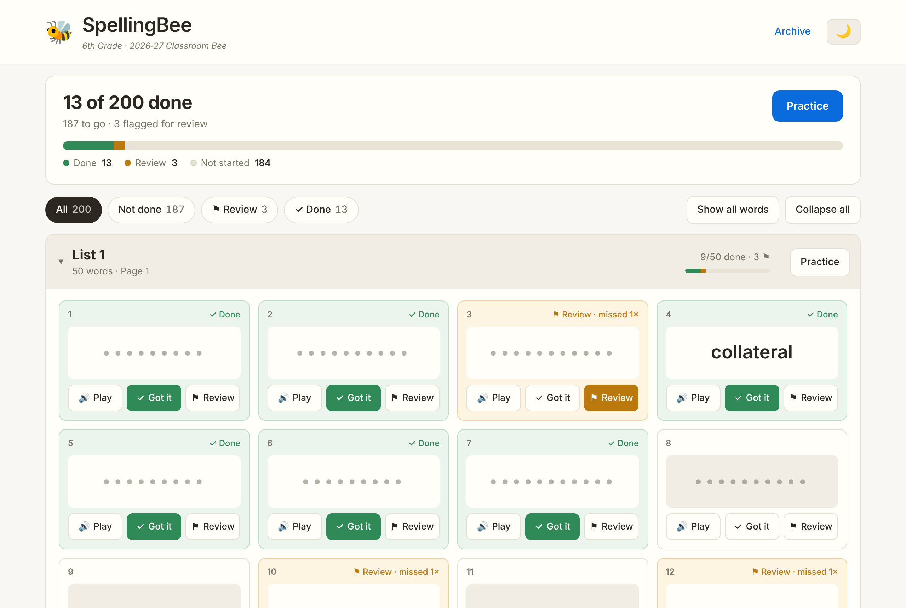
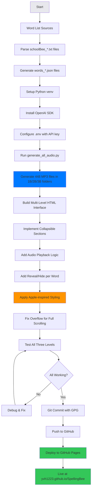

# SpellingBee Practice

A calm, pronunciation-driven spelling practice website for the 6th grade 2026-27 Classroom Spelling Bee, with progress tracking and a practice mode.

**🌐 Live Site:** https://yvh1223.github.io/SpellingBee/



## Features

- **200 words** from the 26-27 Classroom Spelling Bee Study List, in three collapsible lists (50 / 50 / 100)
- **Progress tracking**: mark a word ✓ Got it or ⚑ Review; overall and per-list progress bars
- **Filters**: All / Not done / Review / Done, so you can come back to just the tricky words
- **Practice mode**: hear a word, type it (or spell it aloud and tap Show answer); right answers are marked done, misses are flagged for review with a missed count
  - Pick Not done / Review / All, which lists, and 10 / 20 / all words; random order
  - Slow playback, typo override, and a "practice missed words" round at the end
- Alternate spellings (materialize/materialise, glycerin/glycerine, …) are accepted and shown with the answer
- Progress saved in the browser, with **Save backup / Load backup** to move it between devices
- MP3 pronunciation for every word (OpenAI TTS, Alloy voice), with the browser voice as a fallback
- Light and dark themes, works on phones and tablets, no tracking, ads or logins
- **Archive** page (`archive.html`) keeps last year's 1B / 2B / 3B lists (448 words)

## Quick Start

```bash
# Clone and open
git clone https://github.com/yvh1223/SpellingBee
cd SpellingBee
open index.html
```

## Project Structure

```
/SpellingBee
  index.html                    # 6th grade page: progress, filters, lists, practice mode
  archive.html                  # 2025-26 1B / 2B / 3B lists
  /css
    style.css                   # Base styling and color tokens (both pages)
    app.css                     # 6th grade page components
  /js
    shared.js                   # Audio playback, theme toggle, safe storage
    app.js                      # 6th grade page logic
    archive.js                  # Archive page logic
  /audio                        # Organized by list
    /6th                        # 200 MP3 files for 6th grade words
    /1B                         # 145 MP3 files for basic words
    /2B                         # 158 MP3 files for intermediate words
    /3B                         # 145 MP3 files for advanced words
  /data                         # JSON word data
    words_6th.json              # 6th grade words with lists and alternate spellings
    words_1B.json               # Basic level words
    words_2B.json               # Intermediate level words
    words_3B.json               # Advanced level words
  generate_all_audio.py         # Multi-level audio generation script
  requirements.txt              # Python dependencies
  .env.example                  # API key template
  AUDIO_GENERATION_MULTI.md     # Audio generation guide
  schoolBee_1.txt               # Source: 1B word list
  schoolBee_2.txt               # Source: 2B word list
  schoolBee_3.txt               # Source: 3B word list
```

## Development Workflow



## Audio Generation

See [AUDIO_GENERATION_MULTI.md](AUDIO_GENERATION_MULTI.md) for detailed instructions.

**Quick Generate All Levels:**
```bash
source venv/bin/activate
python generate_all_audio.py
```

- Generates audio for all three levels (1B, 2B, 3B)
- Uses OpenAI `gpt-4o-mini-tts` model
- Voice: Alloy (US English)
- Cost: ~$0.09 for all 448 files
- Skips existing files (use `--force` to regenerate)
- Organizes output into level-specific folders

## Design Principles

- **Pronunciation First**: Audio-driven learning experience
- **Progressive Reveal**: Words masked until revealed
- **Multi-Level Support**: Three difficulty levels with collapsible sections
- **Minimalist UI**: Apple-inspired clean design
- **Calm Colors**: Neutral grays (#fafafa, #e8e8ed, #1d1d1f)
- **Space Efficient**: Grid layout with large readable fonts
- **Smooth Animations**: Expand/collapse transitions with opacity
- **Mobile Friendly**: Responsive breakpoints at 768px and 480px

## Tech Stack

- Pure HTML5, CSS3, Vanilla JavaScript
- No frameworks or dependencies
- OpenAI TTS for audio generation
- Python 3.13+ (with SSL workaround for macOS)
- GitHub Pages deployment

## Word Count Breakdown

| Level | Description | Words | Difficulty |
|-------|-------------|-------|------------|
| 1B | Basic | 145 | Foundational spelling words (e.g., "tag", "elephant", "chocolate") |
| 2B | Intermediate | 158 | Challenging words (e.g., "almanac", "archipelago", "eccentric") |
| 3B | Advanced | 145 | School bee level (e.g., "apocalypse", "silhouette", "tuberculosis") |
| 6th | 2026-27 Classroom Bee | 200 | Lists 1-3 (e.g., "sorceress", "newt", "Bildungsroman") |
| **Total** | | **648** | |

## License

Personal use only - built for Vihaan's spelling bee preparation.
